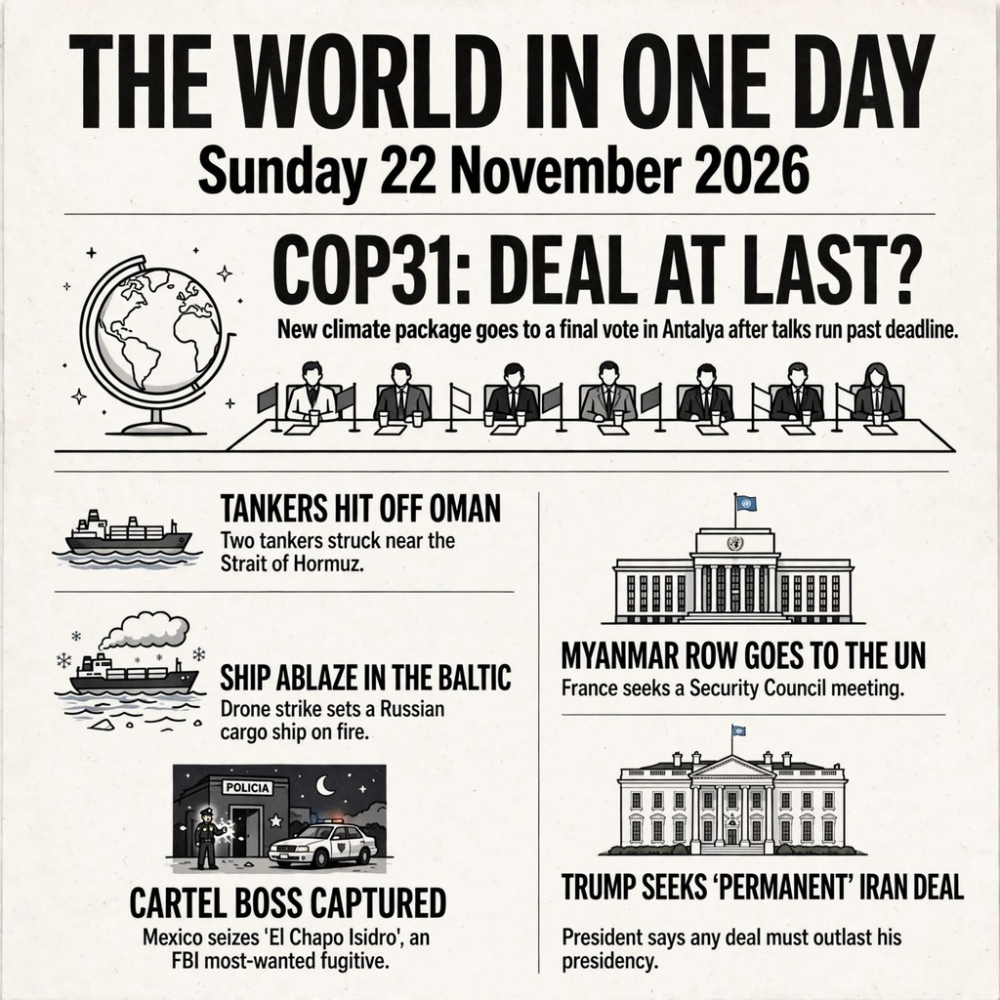

# The World in One Day — 22 November 2026

[](https://make.fun/bounty/news-image-20261122?utm_source=github&utm_medium=readme&utm_campaign=news-image-20261122)
[](https://make.fun/bounty/news-image-20261122/leaderboard?utm_source=github&utm_medium=readme&utm_campaign=news-image-20261122)
[](https://make.fun/bounty/news-image-20261122?utm_source=github&utm_medium=readme&utm_campaign=news-image-20261122)

A make.fun entry for **news-image-20261122**: one image that sums up the
world news of Sunday 22 November 2026.



## The day's stories

1. **COP31: deal at last?** — After the UN climate talks in Antalya ran
   past their Friday deadline, a new compromise package was put to a
   final plenary on Sunday.
2. **Tankers hit off Oman** — Two tankers were struck near the Strait of
   Hormuz on Saturday as Iran tightened its grip on the waterway.
3. **Ship ablaze in the Baltic** — A drone strike set the Russian cargo
   ship Sparta II on fire in the Gulf of Finland on Saturday; it drifted
   into Finnish waters.
4. **Cartel boss captured** — Mexico seized 'El Chapo Isidro', an FBI
   most-wanted fugitive, in a Sinaloa raid on Friday night; 11 people
   were killed in the fighting.
5. **Myanmar row goes to the UN** — France seeks a Security Council
   meeting after Myanmar rejected the world court's genocide ruling on
   the Rohingya.
6. **Trump seeks a 'permanent' Iran deal** — The president says any
   agreement must outlast his presidency.

## How it works

`main.ts` (Node 22, standard library only) copies `entry.png` — a
1024×1024 JPEG under 1 MiB — to `$MAKEFUN_OUTPUT_DIR/entry.png`
(`/output` in the grader). The program is fully deterministic: both
graded runs write byte-identical output.

Run locally:

```sh
mkdir -p out && MAKEFUN_OUTPUT_DIR=out node main.ts
```

## Sources

Stories were verified against the day's reporting (Reuters, AP, Al
Jazeera, 21–22 November 2026). The lead is Sunday's COP31 development;
the other stories are the weekend's news as it stood on Sunday 22
November 2026 — all events from 20–22 November 2026, nothing before
13 November 2026 appears.

## License

MIT — see [LICENSE](LICENSE).
